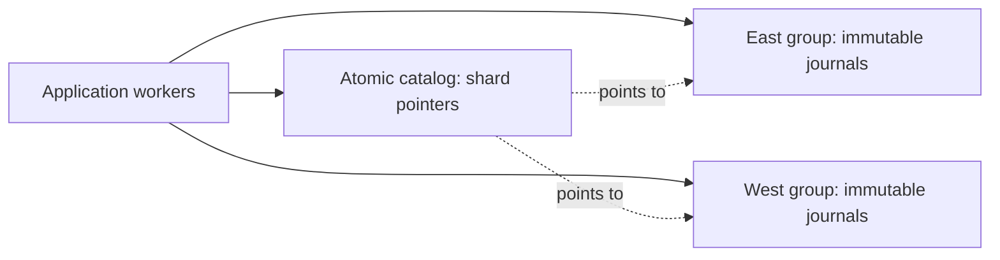

# Coordinated network engines

`ClusterEngine` composes the normal links and names API with an atomic journal
store. Independent application processes select named shards at transaction
start, work privately, and publish their changed journals in one atomic compare
and exchange. Every selected shard's generation is checked, including read-only
shards. This gives conservative serializable transactions within a selected
group. Select every shard on which an application invariant depends. References
are local to a shard; application-level cross-shard references include its name.

Rust implements `LinksStorage<T>` and `NamedTypeLinks`, C# implements
`INamedTypesLinks<T>`, and JS returns a `LinksClient` per selected shard. Commit
belongs to the containing group. The bare cache and local engine APIs retain
no network dependency. Network sessions currently support optimistic admission
and serializable validation; requests for other policies fail explicitly.

## Backends and costs

The replaceable `AtomicJournalStore` / `IAtomicJournalStore` contract requires
linearizable grouped reads, never-reused modification generations, atomic
comparison of every selected key, and atomic publication of all changed keys.
Zero denotes an absent key. A custom store must not silently weaken this contract.
The supplied `EtcdJournalStore` uses etcd's v3 HTTP JSON gateway. One Txn reads the
group; one Txn validates and publishes. Read failures try each configured endpoint
once. A mutation is sent once. No follower-local or stale cached reads are served.

This backend stores full journals in etcd keys. Transaction start transfers and
replays each selected shard's complete journal; commit transfers the complete
updated journals. Defaults bound requests to 1 MiB, responses to 8 MiB, selected
shards to 32, and names to 128 ASCII letters/digits/dots/underscores/dashes. Tune
byte bounds together with etcd's server request/quota limits. These limits are
checked in addition to engine journal integrity, allocator and constraint checks.
This is suitable for small datasets and coordination; it is not a high-throughput
bulk storage design. One consensus group replicates every journal and limits
aggregate write throughput. More workers and separate shard namespaces spread
processing. Use the optional partitioned decorator below to move journal data
out of the catalog into independent stores and consensus groups.

An independently selected [logical checkpoint interval](ENGINE-CHECKPOINTS.md)
bounds the current replay/transfer history when retention is bounded. It uses
the same grouped generation CAS, keeps defaults unchanged and retains old
partitioned objects. History All and full-snapshot checkpoint costs remain
explicit; it does not increase the coordinator's throughput or request limits.

## Independent data stores

`PartitionedJournalStore` implements the same atomic journal store contract in
Rust, C# and JS. Supply a catalog, a map of named data stores, and a function
mapping each shard name to a data-store name. The stores can use separate etcd
deployments, disks, memberships and quotas. No application filesystem is shared.



At begin, the decorator reads all selected catalog pointers in one linearizable
snapshot, then loads their immutable data objects. At commit it creates the
changed objects in their routed stores, verifies their complete contents, then
atomically compares every selected catalog generation and publishes the pointers.
A failed comparison publishes none of the group. A data failure before catalog
publication leaves only unreferenced objects. An unknown catalog response still
requires a fresh read. No data or catalog mutation is automatically retried.

The portable pointer is four strings: `blob1`, partition name, object key, and
object modification generation. Keys use a length-framed UTF-8 FNV-1a-64 index.
Creation checks full contents and rejects a collision; existing objects are never
overwritten. Object downloads verify both generation and index. This detects accidental
corruption and namespace misuse; it does not authenticate an untrusted backend.
Catalog and data namespaces must be dedicated to this protocol. Keep each
partition name bound to its original storage namespace, even when changing the
router for future writes. Never delete or mutate objects: old readers may still
hold pointers. This version retains old and orphan objects, so provision quotas
and monitor growth. No concurrent garbage collector is supplied.

The catalog carries O(selected shards) bounded metadata per operation. Bulk
journal writes and storage capacity are distributed across independent data
groups; each journal still transfers its complete sequence of selected logical
revision records and history, including changes when configured.
Catalog metadata throughput and each individual data group's request/quota limits
remain constraints. Split unrelated transaction domains into independent catalogs
to scale metadata throughput; one transaction cannot span independent catalogs.
This does not promise linear throughput scaling or provide LSM compaction.
`requireDurableFlush` requires the catalog and every configured data store to
declare durable persistence. Injected stores remain caller-owned.

For example, with independent groups on ports 2379 (catalog), 3379 (east) and
4379 (west), append the two data endpoints to any cluster example:

```sh
cargo run --manifest-path rust/Cargo.toml --features etcd --example cluster -- http://localhost:2379 /partitioned/ http://localhost:3379 http://localhost:4379
dotnet run --project examples/cluster-csharp -- http://localhost:2379 /partitioned/ http://localhost:3379 http://localhost:4379
```

The JS constructor accepts the same `EtcdJournalStore` instances:

```js
const journals = new PartitionedJournalStore(catalog, { east, west },
  (shard) => shard === 'a' ? 'east' : 'west');
const engine = new ClusterEngine(binding, journals, { requireDurableFlush: true });
```

The design follows the general immutable-data/atomic-metadata pattern described
in [Apache Iceberg's specification](https://iceberg.apache.org/spec/). The wire
format and engine implementation here are independent of Iceberg's table format.

Select an optional [bounded immutable object cache](ENGINE-OBJECT-CACHE.md) to
avoid repeat downloads of unchanged objects. Catalog reads and publication
checks remain fresh. The zero-budget default retains no objects; payload
accounting, ownership, outage behavior and persistent retention limits are
documented separately. Append `--cache` to the partitioned examples to try it.

An independently selected [bounded immutable chunk policy](protocol/chunked-journal.md)
reuses unchanged complete journal prefixes across appends. Whole-journal writing
remains the default, and upgraded readers accept both formats. Select explicit
record/UTF-8-byte/chunk limits on the same partitioned store. Every update and
route is admitted before staging, and one catalog CAS still checks the complete
group. Fresh staging compares all object contents; full reads and replay remain
linear and catalog metadata grows with chunk count. This policy does not supply
automatic balancing, multi-catalog transactions or epoch-fenced chunk deletion.

## Configuration and ownership

Rust enables HTTP/TLS dependencies only with Cargo feature `etcd`.
`EtcdJournalStore::with_agent` accepts a configured `ureq::Agent`; `headers`
accepts authorization headers. The default agent uses a finite ten-second global
deadline, HTTPS root validation and no redirects. Configure private trust roots,
client certificates and proxies through the agent. Cluster engines retain their
store through an `Arc<Mutex<_>>`; transactions own private engine handles.

C# accepts an optional `HttpClient`, enabling custom TLS, authentication headers
and proxies. The caller owns an injected client and the journal store; disposing
the store disposes only a client it created. `RequestTimeout` bounds the complete
request and streamed response (default ten seconds). Default redirects are disabled.
Cluster transactions are single-threaded and must be disposed. A shared custom
store must make its own operations thread-safe.

JS accepts `fetch`, `headers`, `timeoutMs`, `maxRequestBytes` and `maxResponseBytes`.
The universal entry point imports no Node APIs; the initialized WASM binding is
supplied by the caller. `await using` or `try/finally` closes transactions and frees
all workspaces. Close waits for an in-flight commit and propagates its outcome.
The store remains caller-owned. Browser deployments need appropriate CORS support
from a trusted gateway and must protect credentials.

## Failures and durability

A rejected comparison is a known conflict and publishes none of the group. Each
commit attempt ends its transaction. A lost response, HTTP error or malformed
response after sending commit can have an unknown outcome. Open a new transaction
to discover state; never automatically replay a mutation after an I/O error.
Ordinary uncommitted disposal publishes nothing. An applied commit can survive a
lost response; disposal cannot roll it back. Local validation errors occur before
any coordinator mutation. The local workspaces use volatile journals; the shared
store is the durability boundary.

`requireDurableFlush` checks the backend's declared capability. For etcd this
requires the operator to retain default durable fsync settings and reliable
storage. The adapter cannot verify disks, power-loss protection or a dishonest
custom adapter. With a healthy majority, etcd handles leader election and
membership; without a majority, fresh linearizable reads and commits fail. Use
etcd's own supported membership and backup/recovery tools, keeping engine keys
intact. Never expire/delete keys or roll back the coordinator while applications
are using its generations.

## Reproduce verification

For explicit removal of retired immutable journal objects, select the separately
opened [epoch-fenced reclamation store](ENGINE-RECLAMATION.md). It requires
maintenance-capable dedicated new namespaces and supports 1..31 shards per atomic
group because its epoch occupies one comparison slot. Existing append-only modes
keep their original behavior. The native and WASM reclamation examples also
verify retained history, allocator gaps and stale owned-workspace conflicts
across sequential language handoffs.

The [Rust and C# examples](../examples/cluster-csharp/README.md) and
[JS example](../js/client/examples/cluster.mjs) use the same journal representation.
The bounded [integration runner](../experiments/issue-138/etcd-cluster.mjs) launches
a three-member catalog and two independent data groups, uses JS and optional
native writers, injects a lost commit response and a data-group outage, kills the
elected catalog leader, verifies a surviving-majority commit, and then checks
that majority loss refuses a fresh read. All children are killed
and reaped in `finally`. The JS CI conformance job runs this experiment.

Primary references: [etcd API](https://etcd.io/docs/v3.6/learning/api/),
[JSON gateway](https://etcd.io/docs/v3.6/dev-guide/api_grpc_gateway/),
[guarantees](https://etcd.io/docs/v3.6/learning/api_guarantees/),
[ProtoJSON defaults](https://protobuf.dev/programming-guides/json/).
The JSON protocol omits default `false` fields; adapters distinguish a valid
rejected comparison from an invalid response using the response header.

The etcd adapters also expose an independently selected
[namespace maintenance capability](ENGINE-MAINTENANCE.md): complete bounded
revision-consistent scans and exact-generation conditional deletion. This does
not supply a reclamation policy; existing partitioned stores retain their objects.
