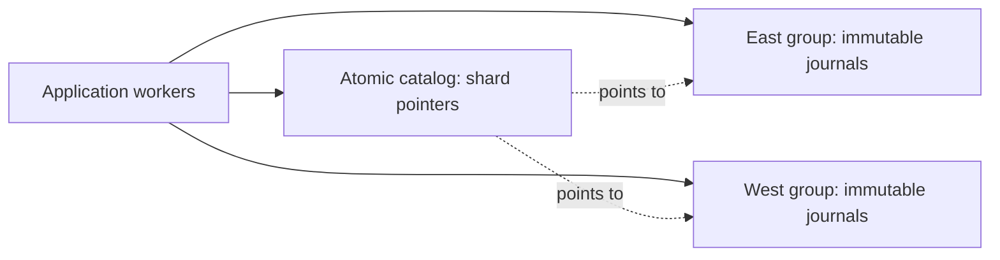

# Coordinated network engines

`ClusterEngine` composes the normal links and names API with an atomic journal
store. Independent application processes select named shards at transaction
start, work privately, and publish their changed journals in one atomic compare
and exchange. Every selected shard's generation is checked, including read-only
shards. This gives conservative serializable transactions within a selected
group. Select every shard on which an application invariant depends. References
are local to a shard; application-level cross-shard references include its name.

Rust implements `LinksStorage<T>` and `NamedTypeLinks`, C# implements
`INamedTypesLinks<T>`, and JS returns a `LinksClient` per selected shard. Commit
belongs to the containing group. The bare cache and local engine APIs retain
no network dependency. Network sessions currently support optimistic admission
and serializable validation; requests for other policies fail explicitly.

## Backends and costs

The replaceable `AtomicJournalStore` / `IAtomicJournalStore` contract requires
linearizable grouped reads, never-reused modification generations, atomic
comparison of every selected key, and atomic publication of all changed keys.
Zero denotes an absent key. A custom store must not silently weaken this contract.
The supplied `EtcdJournalStore` uses etcd's v3 HTTP JSON gateway. One Txn reads the
group; one Txn validates and publishes. Read failures try each configured endpoint
once. A mutation is sent once. No follower-local or stale cached reads are served.

This backend stores full journals in etcd keys. Transaction start transfers and
replays each selected shard's complete journal; commit transfers the complete
updated journals. Defaults bound requests to 1 MiB, responses to 8 MiB, selected
shards to 32, and names to 128 ASCII letters/digits/dots/underscores/dashes. Tune
byte bounds together with etcd's server request/quota limits. These limits are
checked in addition to engine journal integrity, allocator and constraint checks.
This is suitable for small datasets and coordination; it is not a high-throughput
bulk storage design. One consensus group replicates every journal and limits
aggregate write throughput. More workers and separate shard namespaces spread
processing. Use the optional partitioned decorator below to move journal data
out of the catalog into independent stores and consensus groups.

An independently selected [logical checkpoint interval](ENGINE-CHECKPOINTS.md)
bounds the current replay/transfer history when retention is bounded. It uses
the same grouped generation CAS, keeps defaults unchanged and retains old
partitioned objects. History All and full-snapshot checkpoint costs remain
explicit; it does not increase the coordinator's throughput or request limits.

etcd keeps every revision of a key until it is compacted, and its default
backend quota is 2 GiB. Each commit without a checkpoint interval writes the
complete journal again, so a long-running writer must pair a checkpoint
interval with etcd's `--auto-compaction-*` settings and a quota that fits. The
partition test below filled a 16 MiB quota after about 140 commits to one key
(each stored value had grown to about 140 KB). etcd then answers
`etcdserver: no space` with HTTP 429, which the adapter reports as an unknown
outcome, and every later commit fails until an operator compacts, defragments
and disarms the alarm.

## Independent data stores

`PartitionedJournalStore` implements the same atomic journal store contract in
Rust, C# and JS. Supply a catalog, a map of named data stores, and a function
mapping each shard name to a data-store name. The stores can use separate etcd
deployments, disks, memberships and quotas. No application filesystem is shared.



At begin, the decorator reads all selected catalog pointers in one linearizable
snapshot, then loads their immutable data objects. At commit it creates the
changed objects in their routed stores, verifies their complete contents, then
atomically compares every selected catalog generation and publishes the pointers.
A failed comparison publishes none of the group. A data failure before catalog
publication leaves only unreferenced objects. An unknown catalog response still
requires a fresh read. No data or catalog mutation is automatically retried.

The portable pointer is four strings: `blob1`, partition name, object key, and
object modification generation. Keys use a length-framed UTF-8 FNV-1a-64 index.
Creation checks full contents and rejects a collision; existing objects are never
overwritten. Object downloads verify both generation and index. This detects accidental
corruption and namespace misuse; it does not authenticate an untrusted backend.
Catalog and data namespaces must be dedicated to this protocol. Keep each
partition name bound to its original storage namespace, even when changing the
router for future writes. Never delete or mutate objects: old readers may still
hold pointers. This version retains old and orphan objects, so provision quotas
and monitor growth. No concurrent garbage collector is supplied.

The catalog carries O(selected shards) bounded metadata per operation. Bulk
journal writes and storage capacity are distributed across independent data
groups; each journal still transfers its complete sequence of selected logical
revision records and history, including changes when configured.
Catalog metadata throughput and each individual data group's request/quota limits
remain constraints. Split unrelated transaction domains into independent catalogs
to scale metadata throughput; one transaction cannot span independent catalogs.
This does not promise linear throughput scaling or provide LSM compaction.
`requireDurableFlush` requires the catalog and every configured data store to
declare durable persistence. Injected stores remain caller-owned.

For example, with independent groups on ports 2379 (catalog), 3379 (east) and
4379 (west), append the two data endpoints to any cluster example:

```sh
cargo run --manifest-path rust/Cargo.toml --features etcd --example cluster -- http://localhost:2379 /partitioned/ http://localhost:3379 http://localhost:4379
dotnet run --project examples/cluster-csharp -- http://localhost:2379 /partitioned/ http://localhost:3379 http://localhost:4379
```

The JS constructor accepts the same `EtcdJournalStore` instances:

```js
const journals = new PartitionedJournalStore(catalog, { east, west },
  (shard) => shard === 'a' ? 'east' : 'west');
const engine = new ClusterEngine(binding, journals, { requireDurableFlush: true });
```

The design follows the general immutable-data/atomic-metadata pattern described
in [Apache Iceberg's specification](https://iceberg.apache.org/spec/). The wire
format and engine implementation here are independent of Iceberg's table format.

Select an optional [bounded immutable object cache](ENGINE-OBJECT-CACHE.md) to
avoid repeat downloads of unchanged objects. Catalog reads and publication
checks remain fresh. The zero-budget default retains no objects; payload
accounting, ownership, outage behavior and persistent retention limits are
documented separately. Append `--cache` to the partitioned examples to try it.

An independently selected [bounded immutable chunk policy](protocol/chunked-journal.md)
reuses unchanged complete journal prefixes across appends. Whole-journal writing
remains the default, and upgraded readers accept both formats. Select explicit
record/UTF-8-byte/chunk limits on the same partitioned store. Every update and
route is admitted before staging, and one catalog CAS still checks the complete
group. Fresh staging compares all object contents; full reads and replay remain
linear and catalog metadata grows with chunk count. This policy does not supply
automatic balancing or multi-catalog transactions. The separately selected
[reclaiming chunk layout](protocol/reclaiming-chunks.md) adds epoch-fenced
physical retirement. Prefix reuse is limited to one epoch; after a collection
fence, the next publication restages its complete selected journal.

## Configuration and ownership

Rust enables HTTP/TLS dependencies only with Cargo feature `etcd`.
`EtcdJournalStore::with_agent` accepts a configured `ureq::Agent`; `headers`
accepts authorization headers. The default agent uses a finite ten-second global
deadline, HTTPS root validation and no redirects. Configure private trust roots,
client certificates and proxies through the agent. Cluster engines retain their
store through an `Arc<Mutex<_>>`; transactions own private engine handles.

C# accepts an optional `HttpClient`, enabling custom TLS, authentication headers
and proxies. The caller owns an injected client and the journal store; disposing
the store disposes only a client it created. `RequestTimeout` bounds the complete
request and streamed response (default ten seconds). Default redirects are disabled.
Cluster transactions are single-threaded and must be disposed. A shared custom
store must make its own operations thread-safe.

JS accepts `fetch`, `headers`, `timeoutMs`, `maxRequestBytes` and `maxResponseBytes`.
The universal entry point imports no Node APIs; the initialized WASM binding is
supplied by the caller. `await using` or `try/finally` closes transactions and frees
all workspaces. Close waits for an in-flight commit and propagates its outcome.
The store remains caller-owned. Browser deployments need appropriate CORS support
from a trusted gateway and must protect credentials.

## Failures and durability

A rejected comparison is a known conflict and publishes none of the group. Each
commit attempt ends its transaction. A lost response, HTTP error or malformed
response after sending commit can have an unknown outcome. Open a new transaction
to discover state; never automatically replay a mutation after an I/O error.
Ordinary uncommitted disposal publishes nothing. An applied commit can survive a
lost response; disposal cannot roll it back. Local validation errors occur before
any coordinator mutation. The local workspaces use volatile journals; the shared
store is the durability boundary.

`requireDurableFlush` checks the backend's declared capability. For etcd this
requires the operator to retain default durable fsync settings and reliable
storage. The adapter cannot verify disks, power-loss protection or a dishonest
custom adapter. With a healthy majority, etcd handles leader election and
membership; without a majority, fresh linearizable reads and commits fail. Use
etcd's own supported membership and backup/recovery tools, keeping engine keys
intact. Never expire/delete keys or roll back the coordinator while applications
are using its generations.

## The Raft draft

`rust/src/engine/raft.rs` is a draft of the algorithm etcd runs, for users who
want a replicated `AtomicJournalStore` without an etcd deployment. It is
written like etcd's `raft` package, as a pure state machine. `RaftNode` reads
no clock, opens no socket and starts no thread. The caller passes the local
time to `tick` and `step`, delivers the messages from `take_messages` over any
transport, and persists `hard_state` and the log before sending them. The same
code therefore runs in a deployment and in a deterministic simulation. The C#
(`RaftNode.cs`) and JS (`js/client/src/raft.js`) ports follow the same steps.

It implements leader election, log replication and commitment by the current
term's entries, with a no-op entry at the start of every term. Reads go through
the log, as etcd's older quorum reads did, so a read returns the state at its
place in the committed order. No proposal is retried. A proposal lost on the
way to the leader never commits, and the caller's deadline reports an unknown
outcome, as `AtomicJournalStore` requires. Two etcd options are on by default:

- **PreVote.** A node first asks whether it could win before it raises its
  term. A replica that can send but not receive then cannot keep
  disrupting a healthy leader.
- **CheckQuorum.** A leader that has not heard from a majority within an
  election timeout steps down. Followers that heard from a leader within that
  timeout refuse votes. A leader that can send but not receive therefore stops
  blocking an election.

Safety (election safety, log matching, leader completeness, state machine
safety) never depends on a clock. Time decides only when a node starts an
election or a leader sends heartbeats, so skewed clocks can cost
availability but never correctness. The draft has no membership changes, no
snapshots or log compaction, and no ReadIndex or lease reads. Report anything
that breaks.

`rust/tests/engine_raft_simulation_tests.rs` runs three replicas under
`ClusterEngine` members. The simulation owns everything etcd gets from the
operating system:

- **Clocks and timers.** Each replica's clock runs at its own rate (0.5x to 2x
  real time), jumps forward and backward, and changes rate during the run.
  Election timeouts, heartbeats and client deadlines run on these clocks.
- **Processes.** Replicas crash and restart, keeping only their hard state and
  log.
- **Network.** Messages are dropped, delayed and reordered. A replica can be
  isolated, deaf (it sends but does not receive) or mute (it receives but does
  not send).

Clients run random transactions on every member. The Elle-style checker
searches each history for anomalies, including real-time edges, and every
replica must end with the same committed log and state. Four tests run 20
seeds each:

| Test | Faults | Required |
| --- | --- | --- |
| `raft_group_stays_strictly_serializable_and_live_while_one_replica_keeps_failing` | One replica faulty at a time, never stopping | Strictly serializable. A probe reads every few ticks, and no gap between answers exceeds 1,500 real-time ticks (one lost leader costs up to about 600). |
| `without_pre_vote_and_check_quorum_one_faulty_replica_stalls_the_group` | The same schedules with both options off | Negative control: the longest gap exceeds the bound and terms climb more than four times higher. |
| `raft_group_stays_strictly_serializable_when_every_replica_fails` | Any replicas faulty at once | Strictly serializable. Unknown outcomes are found both committed and aborted, and some calls find no quorum. |
| `the_same_seed_replays_the_same_raft_history` | | Identical history and counters |

The Rust run prints its counters, and
[`raft-simulation-expected.txt`](../experiments/issue-138/raft-simulation-expected.txt)
records them. With both options on and one faulty replica, the longest
gap was 1,189 ticks, the highest term 8, and 529 commits over 20 seeds.
Without them on the same schedules, the gap was 2,292 ticks and the highest
term 64. The C# and JS ports print the same numbers for the same seeds.

## Distributed transactions compared

`ClusterEngine` is the optional distributed transaction: one transaction
reads and writes several shards. With `PartitionedJournalStore` those shards
live in independent data stores and consensus groups. Nothing changes for a
program that does not construct it.

| Property | How a cluster transaction provides it | Rust test in `engine_cluster_tests.rs` (C# `EngineClusterTests` and JS `cluster.test.mjs` cover the same cases) |
| --- | --- | --- |
| Atomicity | One compare-and-exchange on the catalog publishes every changed shard, or none of them | `cross_shard_commit_is_atomic_and_checks_read_only_shards` |
| Consistency | Every shard's engine checks its constraints before anything is sent | `invalid_policies_and_coordinates_are_rejected_and_constraints_publish_no_shards` |
| Isolation | Every selected shard's generation is compared, including shards only read, which is conservative serializability | the same atomicity test |
| Durability | The store declares durable persistence, checked with `requireDurableFlush` | `durable_backend_and_boundary_names_are_accepted_but_bad_snapshots_fail_closed` |
| Unknown outcome | A lost reply ends the transaction; a new one reads what was published | `lost_reply_ends_transaction_and_reopen_discovers_all_committed_shards` |

The [integration runner](../experiments/issue-138/etcd-cluster.mjs) repeats
these against real etcd groups, killing the catalog leader.

The commit has one decision point, the catalog write. This is the rule
behind Percolator's primary lock: a transaction is committed exactly when one
record is written, and every other record follows it. Classic two-phase
commit has no such single record. Each participant is first prepared and then
holds its locks until a coordinator tells it the outcome.

| System | Protocol, as documented | What a failure leaves behind | Here |
| --- | --- | --- | --- |
| PostgreSQL [`PREPARE TRANSACTION`](https://www.postgresql.org/docs/current/sql-prepare-transaction.html) | Two-phase commit driven by "an external transaction manager" | A prepared transaction "continues to hold whatever locks it held", and leaving one for a long time interferes with `VACUUM` | No prepared state on any shard. Uncommitted work is private and is dropped with the transaction. |
| MySQL [XA](https://dev.mysql.com/doc/refman/8.4/en/xa.html) | A Transaction Manager prepares every Resource Manager, then commits or rolls them all back | Prepared branches wait for the manager's decision | The catalog store is the only manager. Its compare-and-exchange is the decision. |
| TiKV [Percolator](https://tikv.org/deep-dive/distributed-transaction/percolator/) | Prewrite locks every row, then commit removes the primary lock; a timestamp oracle orders transactions | Secondary locks that readers resolve by checking the primary | One catalog generation per shard instead of per-row locks and timestamps. Readers never resolve locks. |

The [strategy comparison](ENGINE-STRATEGIES.md#costs-and-comparison) also
compares this with etcd `Txn` and Cassandra Accord.

Two-phase commit across independent catalogs, or across separately opened
engines, is not offered. Each catalog would need a prepared state that holds
its shards until a coordinator with its own durable log decides. A crashed
coordinator then leaves shards in doubt, which is the failure PostgreSQL warns
about above. To make shards commit together, put them under one catalog.
Their data can still sit in separate stores. The cost is that the catalog
serializes every transaction's metadata, as described under
[independent data stores](#independent-data-stores).

## Reproduce verification

For explicit removal of retired immutable journal objects, select the separately
opened [epoch-fenced reclamation store](ENGINE-RECLAMATION.md). It requires
maintenance-capable dedicated new namespaces and supports 1..31 shards per atomic
group because its epoch occupies one comparison slot. Existing append-only modes
keep their original behavior. The native and WASM reclamation examples also
verify retained history, allocator gaps and stale owned-workspace conflicts
across sequential language handoffs.

The [Rust and C# examples](../examples/cluster-csharp/README.md) and
[JS example](../js/client/examples/cluster.mjs) use the same journal representation.
The bounded [integration runner](../experiments/issue-138/etcd-cluster.mjs) launches
a three-member catalog and two independent data groups, uses JS and optional
native writers, injects a lost commit response and a data-group outage, kills the
elected catalog leader, verifies a surviving-majority commit, and then checks
that majority loss refuses a fresh read. All children are killed
and reaped in `finally`. The JS CI conformance job runs this experiment.

The [partition runner](../experiments/issue-138/etcd-partition.mjs) cuts the
Raft links of a real three-member etcd cluster without root. Each member
advertises a peer URL served by a [proxy](../experiments/issue-138/etcd-peer-network.mjs)
that reads etcd's `X-Server-From` header and so knows which directed link every
peer connection carries: `POST /raft` connections carry the dialer's messages,
and `GET /raft/stream/...` connections carry messages back to the dialer. A cut
link's connections are destroyed and new ones are held open without
forwarding a byte, so a partition can be two-way, one-way in either direction,
or a bridge, which iptables cannot do for TCP. etcd's prober opens keep-alive
connections without the header and the pipeline later reuses them for
`POST /raft`, so the proxy keeps scanning each connection until a request
names its sender. Without that, a one-way cut leaked messages and the cut
leader kept replicating. A link can also be slowed instead of cut: the proxy
then delays every byte on that link's connections, in order, so messages
arrive late rather than not at all.

The runner checks these scenarios, committing every transaction across two
shards:

1. The leader isolated both ways: the majority elects a new leader and commits,
   the cut member commits nothing, and a transaction staged through it before
   the cut is refused after the heal.
2. A one-way cut from the leader: its followers elect a new leader, and the old
   leader ends up following it.
3. A one-way cut to the leader: CheckQuorum makes it step down.
4. A bridge member connected to both halves: commits continue.
5. Slow links: with every link 50 ms late (etcd sends heartbeats every 100 ms
   and starts an election after 1000 ms), commits continue through every
   member. With the leader's outgoing links 2500 ms late, longer than any
   election timeout, its heartbeats arrive from a term the others have already
   ended, and the majority must still commit. etcd randomizes each member's
   election timeout between one and two times the configured value (1000 to
   1900 ms here). With a 1500 ms delay, both followers sometimes waited out the
   silence, the old leader kept its term, and every commit outlived the
   client's 700 ms deadline. That flake is why the delay is 2500 ms.
6. Six random rounds (seeded by `PARTITION_SEED`) of isolations, single links,
   all links into or out of one member, and one member's outgoing links slowed
   by 100 to 2000 ms, with a second fault injected mid-round while four clients
   commit through single members and through all members.

Afterwards every member must return the same state. Every acknowledged
transaction must be present in both shards and every refused one absent. A
transaction with an unknown outcome must be all or nothing. Each transaction's
first read must include every commit acknowledged before it started (real
time). CI runs seeds 138 and 2026 and uploads the members' logs. The seed fixes
the fault plan, but etcd's timing is real, so the counts differ between runs:
two local runs of seed 138 acknowledged 295 and 258 commits, refused 194 and
174, and left 3 and 2 outcomes unknown. With slow links added, one run of seed
138 acknowledged 344, refused 217 and left 6 unknown, and one run of seed 2026
acknowledged 309, refused 203 and left 1 unknown. CI at `3f10358a` gave 587 /
279 / 5 and 564 / 235 / 3.

Liveness is asserted in bounded form. In scenarios 1 to 5 the side that holds
a majority must commit within 200 attempts. After every heal, every member
must follow one leader within about 100 polls and then commit a transaction
through itself alone. Liveness is not asserted while a random round's faults
last, and which rounds stall varies between runs. Locally, seed 2026's round 3
committed nothing while two members' links were cut. In CI, seed 138's round 5
committed nothing while one member's outgoing links were 1454 ms late. etcd
allows both.

Clocks are not skewed. Correctness here does not read a clock. A commit is an
etcd transaction that compares every selected key's `mod_revision` with the
snapshot it read (`EtcdJournalStore.compareExchange` in
`js/client/src/cluster.js`, and the Rust and C# stores). Time is used only for
request deadlines (`AbortSignal.timeout`), and the engine uses no etcd leases.
A wrong clock therefore can only expire a deadline early or late. That gives
a failed or unknown outcome, which these tests already produce. etcd's own
Raft timers count ticks of Go's monotonic clock. Skewing a member's wall
clock (with libfaketime or a VM) is not tested here.

A deterministic simulation complements the real cluster:
`rust/tests/engine_simulation/network.rs`,
`csharp/Foundation.Data.Doublets.Cli.Tests/EngineSimulationTests.cs` and
`js/client/test/engine-simulation.test.mjs` (on the WASM engine). In it, three
`ClusterEngine` members reach one atomic journal store through simulated links
that drop requests, lose replies, deliver requests late (after other
transactions ran), and are cut or made one-way. Five clients run 80
transactions per history over two shards, 30 seeds in all. The Elle-style
checker shared with the history tests (including real-time edges between
members) must find no anomaly. Commits with unknown outcomes are resolved from
the store's own log, as a reconnecting client would see them. All three
languages produce the same totals: 508 committed, 303 conflicts, 67 unknown
outcomes that committed and 125 that did not, 32 late deliveries, and 1370
transactions that could not start because their member could not reach the
store. A seed replays the same history exactly.

Primary references: [etcd API](https://etcd.io/docs/v3.6/learning/api/),
[JSON gateway](https://etcd.io/docs/v3.6/dev-guide/api_grpc_gateway/),
[guarantees](https://etcd.io/docs/v3.6/learning/api_guarantees/),
[ProtoJSON defaults](https://protobuf.dev/programming-guides/json/).
The JSON protocol omits default `false` fields; adapters distinguish a valid
rejected comparison from an invalid response using the response header.

The etcd adapters also expose an independently selected
[namespace maintenance capability](ENGINE-MAINTENANCE.md): complete bounded
revision-consistent scans and exact-generation conditional deletion. This does
not supply a reclamation policy; existing partitioned stores retain their objects.
