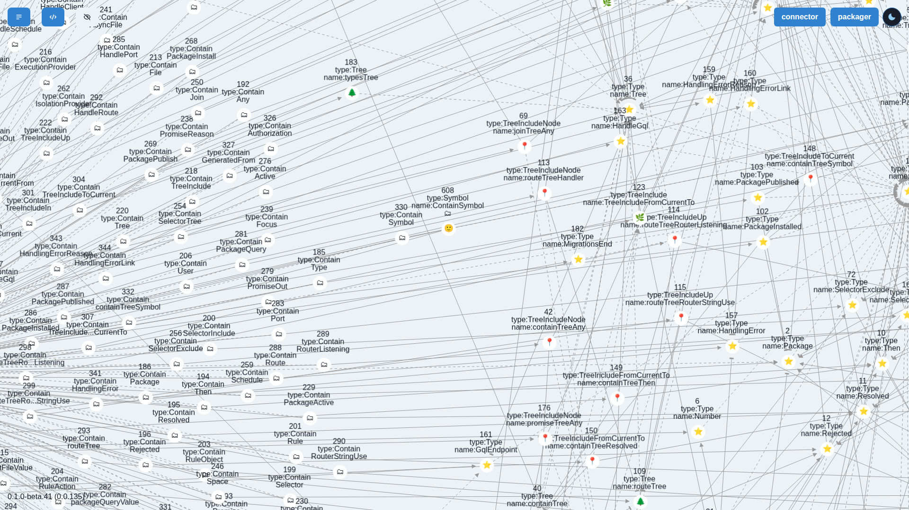

# GraphQL for Deep

`clink --serve <address> --graphql` answers on `/v1/graphql` the way Hasura
answers for [Deep](https://github.com/deep-foundation), so `DeepClient` from
`@deep-foundation/deeplinks` and DeepCase connect to a links database. C# and
Rust serve the same behaviour and pass the same vectors.

```sh
gunzip -c docs/protocol/graphql/deep-fresh.json.gz > fresh.json
clink --db deep.links --serve 127.0.0.1:3006 --graphql --jwt-secret secret \
  --deep-package fresh.json
```

| Option | Meaning |
|--------|---------|
| `--graphql` | Serve GraphQL rather than the links protocol; implies indexed lookups. |
| `--jwt-secret <text>` | Signs the tokens (HS256); random at each start when absent. |
| `--graphql-admin-secret <text>` | The `x-hasura-admin-secret` that bypasses `--permissions`. |
| `--deep-package <file>` | Deep links as JSON rows to load before serving; repeatable. Rows whose id exists are left alone. |
| `--permissions <rules>` | The permission layer of [issue #149](../examples/permissions), judging each subject. |

## How Deep maps to links

| Deep | clink |
|------|-------|
| `links` | A triplet `(index: type from to)` with the external id `deep:<id>`. Only such triplets are rows: what the plain CLI wrote stays invisible. |
| `strings`, `numbers`, `objects` | A triplet of a marker type from the owner, whose value is in its name; it goes with the link. |
| `can` | The grants of the policy. `0` stands for `Anything`; a rule about a link with no Deep id is not shown. Empty without a policy. |
| `tree`, `mp` | Computed from the `Tree*` links until the next write. |
| `selectors` | Computed from the `Selector*` links and `tree`. |
| `handlers` | Empty: handlers do not run here (out of scope). |
| Subject | The JWT's `x-hasura-user-id` claim, read from `Authorization`, or from `connection_init` over WebSocket. |

A `where` is planned into substitution queries of the triplets layer where it
can be: `_eq`, `_in`, `_and`, `_or`, `_not` and the relations `from`, `to`,
`type`, `in`, `out`, `typed`. The other operators filter what those find.
Every mutation is one undoable unit, saved on commit.

Subscriptions are live queries over WebSocket, on the subprotocols `graphql-ws`
(`subscriptions-transport-ws`, which `DeepClient` uses) and
`graphql-transport-ws` (the `graphql-ws` library). Each runs again after a write
and is sent if its answer changed.

## Known differences from Deep with Hasura

- Compared with a real Hasura on a fresh database
  (`experiments/compare-derived-tables.py`), `selectors` is equal row for row.
  `tree` has every reference row plus 9 of 41025 `(tree, link, parent)` rows
  (tree 40, links 587, 588, 589, 760, 1640), as it holds every path. Deep's
  trigger seems to skip these with its `DISTINCT ON (item_id)` when it spreads to
  a path that arrived later; that is read from the trigger, not proven.
- Handlers, and the `/api` routes of DeepCase's own Next server, do not exist.
- With a policy, creating a link needs the right to write its type.
- A cycle in a tree ends the path rather than being refused.

## Verify

- `docs/protocol/graphql/` holds what was recorded from a real Hasura and the
  vectors both languages run (`rust/tests/graphql_vectors.rs`,
  `GraphqlTests.cs`). `rust/tests/graphql_server.rs` covers sockets, tokens and
  restart.
- [examples/deep-client](../examples/deep-client) runs the real `DeepClient`.

## DeepCase

DeepCase keeps its endpoint in the `dc-dg-path` local storage key, for example
`"localhost:3006/v1/graphql"`. It logs in as a guest and shows its space; add
`?space-id=184` to see the links of `@deep-foundation/core`:


